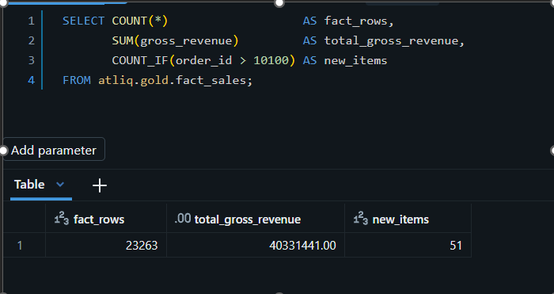
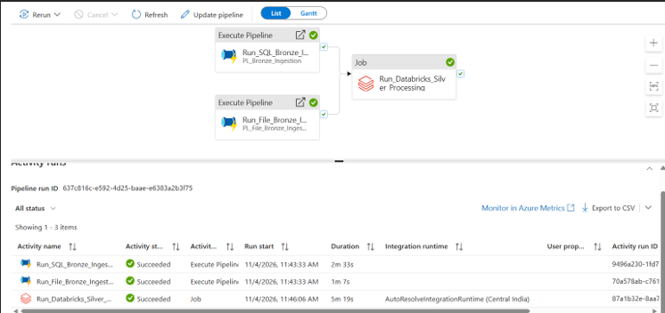
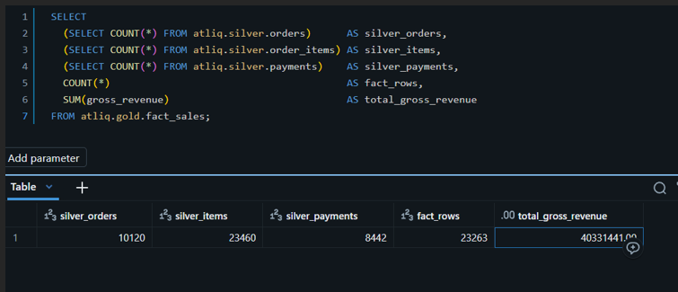

# AtliQ Commerce — End-to-End Data Engineering Capstone

**Detailed technical documentation and evidence register | Updated: 10 November 2026**  
**Repository:** https://github.com/Thilagavathi36/capstore-batch-data-processing  


## 1. Business problem and objective

AtliQ Commerce is an e-commerce business whose operational system records customers, products, orders, order items, and payments. The objective is to move analytical workloads away from the transactional Azure SQL database, ingest changed data reliably, clean known source issues, build a reporting-friendly star schema and web-session funnel, and publish business insights in Microsoft Fabric / Power BI.

Business questions: revenue over time; highest-revenue products/categories; highest-revenue cities; new versus returning purchasing customers; website funnel from sessions through purchases. The dashboard currently also shows order count, customer count and average order value.

## 2. End-to-end architecture

```text
Azure SQL Database (OLTP, 3NF)       ADLS landing files
  customers, products                 supplier_price_list.csv
  orders, order_items, payments       marketing_spend.csv
  etl.control_table                   clickstream JSON/JSONL
          |                                  |
          +------------ Azure Data Factory -+
                           metadata-driven ingestion
                           control-table + watermark
                                      |
                       ADLS Gen2 /lakehouse/bronze/
                    SQL Parquet + CSV text + raw clickstream
                                      |
                      Azure Databricks / PySpark
                   Bronze -> Silver Delta (Unity Catalog)
                 cleaning, dedup, MERGE, quarantine, dq_log
                                      |
                       dbt Core + dbt-databricks
                  staging views -> Gold star schema tables
                                      |
                   ADLS external Gold Delta + Fabric
                     Power BI semantic model/report

GitHub repository + PR dbt CI | Databricks Workflow | retries
failure email notifications | run audit | table-count snapshots
```

**Azure resources identified in project discussions**

| Component | Identifier / implementation |
|---|---|
| Resource group | `rg-atliq-capstone` |
| Azure SQL server | `atliq-capstone-sql-36.database.windows.net` |
| Azure SQL database | `atliq_commerce` |
| Azure Data Factory | `adf-atliq-capstone-36` |
| ADLS Gen2 storage | `cdstlakehouse` |
| ADLS container | `lakehouse` (hierarchical namespace enabled; private) |
| Azure Databricks workspace | `dbw-atliq-capstone` |
| Unity Catalog | `atliq` |
| Silver schema | `atliq.silver` |
| Gold schema | `atliq.gold` |
| dbt project | `atliq_gold` |
| Fabric dashboard | `AtliQ_Commerce_Dashboard` |
| Fabric Lakehouse | `AtliQ_Gold_Lakehouse1` |


## 3. M1 — Azure SQL OLTP and source foundation


- Provisioned Azure SQL server and `atliq_commerce` database.
- Created/loaded normalized source tables for `customers`, `products`, `orders`, `order_items`, and `payments`.
- Verified source data with SQL queries; connected through the VS Code MSSQL extension.
- Set up ETL metadata/control table (`etl.control_table`) to declare which tables are full loads or incremental, their watermark columns, and last successful load timestamps.
- Source watermark design: `orders.updated_at`, `payments.updated_at`, `order_items.created_at`; customers/products are full refreshes.
- The guide supplies a Python daily order simulator for new and updated orders and a stored procedure for watermark advancement. 

**Design decision:** OLTP is normalized for frequent transactional writes; analytical work is separated into a star-schema OLAP layer so reporting does not burden the source application.

## 4. M2 — Azure Data Factory and ADLS Bronze ingestion


- Created ADF `adf-atliq-capstone-36` and ADLS Gen2 `cdstlakehouse/lakehouse`.
- Used a **single metadata-driven ADF pipeline** instead of separate pipelines for each source table.
- Pipeline reads `etl.control_table`, loops through metadata, and routes full vs incremental ingestion.
- `run_start_at` is captured at pipeline start. The watermark is advanced only after the corresponding successful copy, using the run-start timestamp to avoid skipping mid-run updates.
- Full-load SQL sources include `customers` and `products` and are overwritten as current Bronze snapshots.
- Incremental SQL sources include `orders`, `order_items`, and `payments`; batches are stored under dated paths such as `bronze/orders/ingest_date=YYYY-MM-DD/`.
- Source SQL tables land as **Parquet** in Bronze, not Delta.
- CSV sources `supplier_price_list` and `marketing_spend` are ingested as full snapshots with raw text retained for Silver parsing.
- Web clickstream files are copied unchanged; malformed records are intentionally handled later in Silver rather than rejected by ADF.
- ADF pipeline assets are version-controlled under `adf/` in GitHub, per previous milestone discussions.

**Rerun safety:** Same-day incremental Bronze batches should replace the same dated batch rather than accumulate duplicates. An earlier test exposed 45 rows where 25 were expected because of an append behavior; later M2 status reported rerun handling complete. Final evidence should explicitly show the current same-day overwrite behavior.

**Operational status:** The ADF scheduled trigger is **intentionally stopped** during capstone testing; this is not a claim of a currently running unattended nightly schedule. Last previously noted successful ADF orchestration was 2026-11-04. A 2026-11-04 Bronze batch existed for orders/items/payments; a 2026-11-06 batch did not because the trigger was stopped.

## 5. M3 — Databricks Bronze to Silver, data quality and Delta


- Configured Azure Databricks, Unity Catalog `atliq`, and Silver/Gold schemas.
- Silver processing reads Bronze Parquet/CSV/raw clickstream and writes cleaned **Delta** tables.
- Main processing notebook: `M3_FINAL_01_Bronze_to_Silver`.
- DQ logging notebook: `M3_FINAL_02_Update_DQ_Log`.
- Silver tables: `customers`, `products`, `supplier_price_list`, `marketing_spend`, `orders`, `order_items`, `payments`, `web_events`.
- Additional operational tables include clickstream quarantine, `dq_log`, and later M7 audit tables.
- Full-refresh datasets are cleaned and overwritten; transactional `orders`, `order_items`, and `payments` are upserted using Delta `MERGE` keyed by their business identifiers.
- Incremental batches use latest-row-per-key selection to avoid multiple source matches and duplicate inserts. Update only when source timestamp is newer where applicable.
- Missing date-partitioned incremental input is treated as a quiet night rather than a reason to fabricate an empty Parquet file.

### 5.1 Cleaning and normalization implemented

| Dataset | Rules / examples |
|---|---|
| Customers | Trim/proper-case cities; map Bombay→Mumbai, Madras→Chennai, Calcutta→Kolkata, Bangalore→Bengaluru; lowercase/trim emails; flag test accounts |
| Products | Parse supplier costs containing currency symbols; normalize supplier date formats; deduplicate as required |
| Orders | Standardize order statuses; derive legacy order date from `created_at`; merge updates by `order_id` |
| Order items | Deduplicate incremental batch by item ID; merge into Silver by item ID |
| Payments | Normalize UPI, Credit Card, Debit Card, Net Banking, Wallet, COD; merge by payment ID |
| Marketing spend | Normalize channels (including Facebook Ads→Meta Ads, influencer/SEO variants); parse comma-separated click counts; inspect negative spend |
| Web events | Parse raw clickstream; quarantine malformed records; filter bots; validate event type, session, timestamp and product references |

### 5.2 Historical DQ evidence

Previously observed rule counts include: city case/whitespace normalization **101**, Bombay→Mumbai **12**, Madras→Chennai **3**, Bangalore→Bengaluru **13**, Calcutta→Kolkata **1**, email normalization **52**, test accounts **8**, supplier cost parsing **33**, supplier date parsing **40**, legacy order date recovery **55**, Facebook Ads→Meta Ads **30**, influencer normalization **605**, SEO normalization **610**, and successfully parsed marketing click values **458** matched rows (461 parseable input rows, 3 unmatched). These are **historical batch/checkpoint observations**, not guaranteed counts for every future rerun.

Previously verified web-events quality checks: **93,436** Silver events; **23,193** distinct sessions; zero duplicate event IDs, missing session IDs, null event timestamps, invalid event types, remaining bot events, and unknown products at that checkpoint.

### 5.3 DQ log

`atliq.silver.dq_log` records `run_date`, `table_name`, `rule`, `rows_affected`. Records are merged by the `(run_date, table_name, rule)` key so reruns do not duplicate rule records. Previous verification found zero duplicate DQ-log key groups. Rule counts should be reviewed after each run for unusual spikes.

## 6. M4 — dbt modeling, staging and Gold


- Created dbt Core project `atliq_gold` on Windows/VS Code using `dbt-core 1.12.5` and `dbt-databricks 1.12.7`.
- `dbt debug`, parsing, source discovery, model runs and builds were tested.
- Connection uses Unity Catalog `atliq`, schema `gold`, and a Databricks SQL warehouse; credentials are supplied through environment variables.
- Declared eight Silver sources in `sources.yml`.
- Created **six staging views**; known named examples: `stg_customers`, `stg_orders`, `stg_order_items`, `stg_payments` (plus `stg_products` and `stg_supplier_price_list`).
- Created **five Gold tables**: `dim_customer`, `dim_product`, `dim_date`, `fact_sales`, `fact_web_sessions`.
- Added **17 dbt tests**. Total validated build resources: **6 staging views + 5 Gold tables + 17 tests = 28**.
- `dbt build` and CI reported **PASS=28, WARN=0, ERROR=0, SKIP=0**.

### 6.1 Staging business logic

- `stg_customers`: source customer attributes, including test-account indicator.
- `stg_orders`: joins to customer staging and excludes test-customer orders. At a prior checkpoint, 10,100 Silver orders became 10,061 staging orders after excluding 39 test-customer orders.
- `stg_order_items`: uses `ROW_NUMBER` to remove duplicate item rows; a previous checkpoint removed 102 duplicates (23,409→23,307).
- `stg_payments`: ranks candidate payments per order, choosing the first by `paid_at ASC NULLS LAST, payment_id ASC`, and joins to valid staged orders; a previous checkpoint identified 110 duplicate payment groups.
- Product and supplier-price staging support the product dimension; the session fact uses the modeled web-event source logic. No separate `stg_web_events.sql` appears in the repository screenshot.

### 6.2 Gold analytical model

| Gold table | Role / grain |
|---|---|
| `dim_customer` | Reporting customer attributes; test customers excluded from relevant analysis |
| `dim_product` | Product attributes for category and product analysis |
| `dim_date` | Shared reporting calendar |
| `fact_sales` | One row per deduplicated order item, for order-line sales and revenue analysis |
| `fact_web_sessions` | Session-level web funnel / behavior reporting |

Gold is modeled for analytic reads. Gold Delta tables are written to external ADLS locations; the CI target is isolated from the production Gold location. The user's actual Gold models are currently **table materializations/full rebuilds**, not claimed to be dbt incremental models.


## 7. M5 — Orchestration, incremental sync and idempotency


- ADF handles Bronze ingestion and source watermarks.
- Databricks Workflow `JOB_M5_Silver_Processing` executes Silver processing, DQ logging and Gold dbt build in dependency order.
- A fourth M7 audit task was subsequently added (see M7).
- Job parameter `run_date={{job.start_time.iso_date}}` is supplied to Silver/DQ tasks; audit receives `job_run_id={{job.run_id}}`.
- Silver Delta MERGE prevents repeat insertion of existing transactional keys; Gold tables rebuild from cleaned Silver inputs.
- Workflow is configured for **maximum one concurrent run** and queueing.
- The pipeline was successfully rerun using an existing `run_date=2026-11-04` batch, with a full four-task success reported on 2026-11-06.

**Idempotency evidence to include in final submission:** Execute the same complete input twice without source changes, and compare both `COUNT(*)` and `SUM(gross_revenue)` on `atliq.gold.fact_sales`. 











## 8. M6 — Microsoft Fabric, semantic model and dashboard


- Fabric Lakehouse identified as `AtliQ_Gold_Lakehouse1` in earlier discussions.
- Power BI report name: `AtliQ_Commerce_Dashboard`.
- Dashboard screenshots showed four KPI cards: **Net Revenue**, **Total Orders**, **Total Customers**, **Average Order Value**.
- Report visuals shown: monthly Net Revenue trend; Net Revenue by product; Net Revenue by city; website conversion funnel; date range and category slicers.
- Example full-selection KPI snapshot previously shown: **28.74M** net revenue, **10K** orders, **906** customers, **4.05K** average order value. With Electronics selected, a screenshot showed **3.87M**, **1K**, **487**, **5.27K** respectively. These are filter-dependent snapshots, not universal totals.
- Dashboard UI changes already made in existing report: light grey page background, white rounded KPI cards, adjusted card dimensions/spacing, visual styling; `(Blank)` removed from category slicer.
- User reported **dashboard pushed to GitHub**, but separately stated the **data/semantic model had not yet been pushed**. Do not mark the semantic model as version-controlled without checking the repository.


## 9. M7 — CI/CD, reliability, run auditing and alerts

**Implemented and verified through CI and controlled workflow tests.**

### 9.1 Git repository and CI

- Repository: `Thilagavathi36/capstore-batch-data-processing`.
- GitHub Actions workflow: `.github/workflows/dbt-ci.yml`.
- Workflow runs on relevant pull requests, uses `actions/checkout@v4`, `actions/setup-python@v5`, Python 3.12, `dbt-core==1.12.5`, `dbt-databricks==1.12.7`, and `dbt build --target ci`.
- Secrets are read from `DATABRICKS_HOST`, `DATABRICKS_HTTP_PATH`, `DATABRICKS_TOKEN`; no tokens should be embedded in tracked profiles or workflow files.
- dbt profile uses separate `dev` and `ci` targets; CI schema `gold_ci` is isolated from development/production `gold`, including external Gold storage paths.
- CI validation passed **28 resources** with no warnings/errors/skips.
- A test PR was merged to main (previously noted merge commit `c358a83`).

### 9.2 Databricks workflow and task dependencies

```text
M3_FINAL_01_Bronze_to_Silver
       |
       v
M3_FINAL_02_Update_DQ_Log
       |
       v
M5_dbt_Gold_Build
       |
       +-------------------------+
                                 v
M7_Pipeline_Run_Audit (run_if: ALL_DONE)
```

The audit task explicitly depends on all three upstream tasks and uses `ALL_DONE`, so it can execute and record a failure even when an earlier stage fails or later stages are skipped.

**Retry configuration in latest job YAML:**

| Task | Max retries | Retry interval | On-failure email |
|---|---:|---:|---|
| Bronze → Silver | 3 | 5 min | Configured |
| Update DQ log | 2 | 5 min | Configured |
| dbt Gold build | 2 | 5 min | Configured |
| M7 audit | 2 | 5 min | Configured |

Queueing is enabled. Task-level email notifications are configured for all four tasks. A job-level on-failure notification is also present.

### 9.3 Why task-level failure notifications matter

A controlled test set `run_date=not-a-date`, causing the first notebook to fail immediately with a date-parsing error **before any data writes**. Downstream processing tasks were skipped and the `ALL_DONE` audit task completed. The overall job could show **“Succeeded with failures”**, so the job-level “On failure” email did not trigger in that scenario. Task-level failure notifications were then configured and **the user confirmed receipt of the failure email**. Screenshot evidence was saved.

### 9.4 Run audit table

`atliq.silver.pipeline_run_audit` is a Delta table with:

```text
run_id STRING
pipeline_name STRING
run_date DATE
start_time TIMESTAMP
end_time TIMESTAMP
status STRING
rows_processed BIGINT
error_message STRING
```

The audit notebook uses the Databricks Jobs Runs API to inspect upstream task result states. It writes **SUCCESS** only when all three processing tasks succeeded; otherwise **FAILED** with a summarized task-state message. Records are written via idempotent Delta `MERGE` keyed by `run_id`.

**Important accuracy note:** `rows_processed` is currently **NULL**, intentionally. Current total table sizes must not be mislabeled as per-run processed counts. In the observed success record, `run_date` reflected the job's **execution date** (2026-11-06), while the Bronze input parameter used **2026-11-04**; these are distinct concepts.

**Verified successful audit record:**

```text
run_id:        964179792108871
pipeline_name: JOB_M5_Silver_Processing
run_date:      2026-11-06
status:        SUCCESS
start_time:    2026-11-06T08:19:10.162+00:00
end_time:      2026-11-06T08:24:10.467+00:00
error_message: null
```

### 9.5 Table-count snapshot audit

`atliq.silver.pipeline_table_counts` stores:

```text
run_id STRING
table_name STRING
row_count BIGINT
recorded_at TIMESTAMP
```

The audit notebook counts **8 Silver** plus **5 Gold** tables, excludes staging views, and idempotently MERGEs records by `(run_id, table_name)`. These are **snapshot counts of entire tables at audit time**, not new rows processed in that job.

**Verified snapshot for run `964179792108871`:**

| Table | Rows |
|---|---:|
| atliq.silver.customers | 1,008 |
| atliq.silver.products | 60 |
| atliq.silver.supplier_price_list | 111 |
| atliq.silver.marketing_spend | 3,037 |
| atliq.silver.web_events | 93,436 |
| atliq.silver.orders | 10,120 |
| atliq.silver.order_items | 23,460 |
| atliq.silver.payments | 8,442 |
| **Silver subtotal** | **139,674** |
| atliq.gold.dim_customer | 1,000 |
| atliq.gold.dim_date | 1,461 |
| atliq.gold.dim_product | 60 |
| atliq.gold.fact_sales | 23,263 |
| atliq.gold.fact_web_sessions | 23,193 |
| **Gold subtotal** | **48,977** |
| **Total snapshot rows (13 tables)** | **188,651** |


## 10 How to run / validate (operational checklist)

1. Verify Azure SQL source and `etl.control_table` state; ensure no secrets appear in logs.
2. Manually trigger `PL_Nightly_Orchestration` in ADF if a fresh Bronze load is needed (the scheduled trigger is intentionally paused).
3. Check dated Bronze partitions for incremental orders, order items, and payments; check full-snapshot CSV/clickstream files.
4. Run Databricks `JOB_M5_Silver_Processing` with the appropriate `run_date` (the Bronze partition date); keep `job_run_id` dynamic.
5. Confirm Bronze→Silver, DQ logging, and dbt Gold build succeeded, followed by the `ALL_DONE` audit task.
6. Inspect `atliq.silver.dq_log`, `atliq.silver.pipeline_run_audit`, and `atliq.silver.pipeline_table_counts` for that run.
7. Verify `fact_sales` count and gross revenue, model tests, and the Power BI report refresh/filters.
8. For a rerun test, repeat with **the same input** and compare `fact_sales` count and gross revenue; do not generate new source data between tests.

**CI:** Pull requests touching `atliq_gold/**` or the workflow run the GitHub Actions `dbt build --target ci`. The CI schema is isolated from the production `gold` schema. Required Databricks connection values are GitHub secrets, not repository files.

